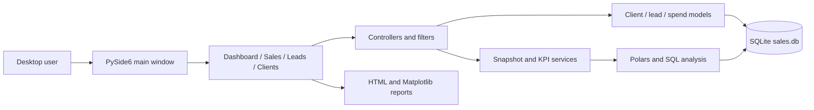

# Techset LeadGen

**Techset LeadGen** is a local desktop application for importing sales and lead data, understanding pipeline performance, maintaining client records, and exporting shareable HTML reports. It is built with Python, PySide6 (Qt Widgets), Polars, Matplotlib, and SQLite.


The application is local-first: the desktop process owns the interface and business logic, while a local SQLite database stores the data. The current repository does not contain a web backend, REST API, account system, browser router, PWA manifest, or cloud synchronization.

## What the application does

| Area | Current capability |
|---|---|
| **Dashboard** | Shows sales-record, client, lead, conversion, meeting, recent-import, and current-month KPIs. It also provides import shortcuts, sample templates, navigation actions, and confirmed data-clearing actions. |
| **Sales** | Filters sales by date, client, and product; calculates totals and average ticket; displays product distribution, time evolution, and top clients; and compares period A with period B. |
| **Leads** | Filters the pipeline by source, stage, date, and search text; shows funnel conversion, meetings, source performance, upcoming meetings, CPL, CAC, attributed revenue, and ROI; updates lead status or meeting date; and adds, corrects, or deletes marketing spend records. |
| **Clients** | Searches and manages client records, shows linked sales and lead information, opens client profiles, merges duplicate names, and exports an individual client report. |
| **Import** | Detects sales, leads, mixed sales-and-leads, or marketing-spend files; previews their schema; validates rows; writes accepted rows in a transaction; and records rejected rows separately. |
| **Reports** | Produces self-contained branded HTML reports for sales analysis, lead performance, and client profiles. Matplotlib charts are embedded as base64 images. |
| **Appearance** | Provides light and dark themes (remembered between sessions) using the official Techset Solutions logo, Inter typography, and centralized brand tokens. |

For a module-by-module explanation and workflow diagrams, read [Architecture](docs/ARCHITECTURE.md). For asset provenance and design tokens, read [Branding](docs/BRANDING.md).

## Runtime overview



## Technology and supported versions

The project metadata requires Python `>=3.12,<3.16`, matching the supported range of the latest PySide6 release. The current lock file resolves the principal packages as follows:

| Purpose | Package | Locked version |
|---|---|---:|
| Desktop UI | `pyside6` | 6.12.0 |
| Legacy UI (declared, no longer imported) | `flet`, `flet-desktop`, `flet-charts` | 1.0.4 |
| Dataframes | `polars` | 2.0.0 |
| Excel import | `openpyxl` | 3.1.5 |
| Date parsing utilities | `python-dateutil` | 2.9.0.post0 |
| Report charts | `matplotlib` | 3.11.2 |
| Numerical support | `numpy` | 2.5.4 |
| Tests | `pytest`, `pytest-cov` | 9.1.1, 7.1.0 |
| Quality and security | `ruff`, `mypy`, `bandit`, `pip-audit` | 0.17.1, 2.4.0, 1.9.4, 2.10.1 |
| Legacy Flet web smoke tests (no longer used) | `flet-cli`, `flet-web`, compatible `fastapi` | 1.0.4, 1.0.4, 0.144.0 |

`pyproject.toml` and `poetry.lock` are the dependency sources of truth.
The Flet packages and the FastAPI pin (below 0.145, for Flet Web 1.0.4) date from
the retired Flet interface. No module imports them any more; they are candidates
for removal with `poetry remove`, which will also regenerate the lock file.

## Setup with Poetry

Prerequisites:

- Python 3.12 or newer, but lower than Python 4
- Poetry 2.x
- A desktop session supported by Qt 6 (Windows, macOS, or Linux on X11 or Wayland)

From the project root:

```bash
poetry install
poetry run python main.py
```

Poetry installs both runtime and development dependency groups from the lock file. On Linux, if Qt reports that it could not load the `xcb` platform plugin, install the distribution's Qt runtime libraries (on Debian/Ubuntu: `libxcb-cursor0`).

### First run

1. `main.py` creates and migrates `data/sales.db` automatically.
2. The application opens on **Dashboard**; the sidebar switches between Dashboard, Sales, Leads, and Clients (Ctrl+1 to Ctrl+4).
3. Choose **Import data** (or press Ctrl+I), select a `.csv` or `.xlsx` file, inspect the preview, and confirm the import.
4. Use the Sales and Leads filters to build analytics, then export an HTML report when needed.

The window opens at 1360 × 860 px and can shrink to 760 × 600 px. Below 980 px wide the sidebar collapses to icons with tooltips.

## Import formats

The interface accepts `.csv` and `.xlsx`; the importer also understands `.xlsm` when invoked directly. The maximum file size is 50 MB.

| Detected type | Required logical columns | Optional logical columns |
|---|---|---|
| Sales | `client_name`, `client_id`, `product_type`, `price` | `date` |
| Leads | `created_at`, `source` | `external_id`, `status`, `meeting_date`, `client_id` |
| Marketing spend | `source`, `amount` | `date` |
| Mixed | A single file satisfying both the Sales and Leads required-column sets | The optional Sales and Leads columns above |

Sales and marketing-spend imports recognize common English and Spanish aliases; lead imports recognize their documented platform-oriented aliases. CSV encoding and delimiter detection supports UTF-8, UTF-8 with BOM, Windows-1252, comma, semicolon, tab, and pipe-separated input.

Import behavior:

- A missing sales or marketing-spend date defaults to the current date.
- Sales imports create missing clients using the imported client ID and name.
- Sources such as Facebook, Instagram, Google, LinkedIn, and TikTok are normalized to stable source codes.
- Lead imports use `(external_id, source)` to avoid repeat imports when an external ID exists. Leads can remain unlinked when their `client_id` is absent from the client table.
- Mixed imports write sales first, making imported clients available before their leads are processed.
- Invalid rows are skipped and written to `data/failed_*.csv` with a reason. Accepted rows remain importable even when other rows fail validation.
- A process-wide lock permits only one import job at a time.
- Re-importing sales or marketing spend adds another set of records; those types are not de-duplicated.

Use ISO `YYYY-MM-DD` dates for unambiguous imports. Slash dates are interpreted day-first.

## Storage, backup, and recovery

The database is SQLite in WAL mode with foreign keys enabled. Its schema is documented in [core/SCHEMA.md](core/SCHEMA.md).

- The default database path is `data/sales.db`.
- Import history is stored in `import_metadata`.
- Application and importer logs rotate at 1 MB with three backups.
- Deleting a client also deletes its sales because the foreign key uses `ON DELETE CASCADE`; linked leads are retained and their `client_id` becomes `NULL`.
- To back up safely, close the application and copy `sales.db` together with `sales.db-wal` and `sales.db-shm` when those files exist.
- `poetry run python scripts/audit_db.py` prints a read-only database summary.

## Configuration

The following environment-variable names are retained as **legacy compatibility interfaces**. Renaming them would break existing deployments even though the visible product name is Techset LeadGen.

| Variable | Default | Purpose |
|---|---|---|
| `FDT_DATA_DIR` | `<project>/data` | Overrides the directory containing `sales.db` and rejected-row CSV files. |
| `FDT_LOG_DIR` | `<project>/logs` | Overrides the directory containing `app.log` and `importer.log`. |
| `FDT_LOG_LEVEL` | `INFO` | Sets the application log level. `TSLG_LOG_LEVEL` takes precedence when both are set. |

Example:

```bash
FDT_DATA_DIR=/path/to/writable/data \
FDT_LOG_DIR=/path/to/writable/logs \
FDT_LOG_LEVEL=DEBUG \
poetry run python main.py
```

When packaged as an executable, the default data and log folders are resolved beside the executable. That location must be writable, or the legacy directory overrides must point to writable folders.

## Reports

Reports are generated locally and do not upload data. The save dialog chooses the destination. After a Sales export, **Open report** opens the file in the default browser; Leads and Client exports are saved to the chosen path.

- Sales reports consume the same `AnalysisSnapshot` displayed by the Sales page, including normal or comparison mode.
- Lead reports consume the active filtered lead set and include funnel, source, and optional marketing-efficiency sections. The lead-detail table is limited to the first 50 records.
- Client reports use the selected client record and the most recent sales returned by the client statistics query.
- Client tax ID, email, and contact fields are masked in branded HTML until hover or keyboard focus.

## Development checks

Run checks from the project root through Poetry so they use the locked environment:

```bash
poetry check
poetry build
poetry run pytest
poetry run pytest --cov
poetry run ruff check .
poetry run mypy
poetry run bandit -c pyproject.toml -r . --severity-level medium --confidence-level high
poetry run pip-audit
```

The root `conftest.py` redirects `FDT_DATA_DIR`, `FDT_LOG_DIR`, and `XDG_CONFIG_HOME` to a temporary folder during pytest runs, so tests never modify the normal database, logs, or saved theme. GUI tests run headless (`QT_QPA_PLATFORM=offscreen`) against the real widgets, and `tests/qt_helpers.py` answers the production dialogs instead of mocking them. `tests/test_audit_regressions.py` covers the defects recorded in [docs/quality/DEFECT_LOG.md](docs/quality/DEFECT_LOG.md). Test counts are intentionally not recorded here because they change with the suite.

`poetry build` produces a Python wheel and source archive in `dist/`. The project
also runs directly from source with `poetry run python main.py`. A platform-native
desktop-installer configuration is not defined in this repository, so the wheel,
source archive, headless GUI tests, and source startup are the applicable
build checks.

## Project map

```text
TSLG/
├── main.py                 # Logging, QApplication, database initialization, startup errors
├── branding.py             # Product copy and branded asset names
├── pyproject.toml          # Python constraints, dependencies, and quality-tool config
├── poetry.lock             # Reproducible dependency resolution
├── assets/                 # Official logos, app icons, and bundled Inter font
├── desktop_ui/             # PySide6 shell, theme, import bridge, shared widgets
│   └── pages/              # Dashboard, Sales, Leads, Clients pages and their dialogs
├── controllers/            # UI state, validation, filtering, and workflow coordination
├── services/               # Dashboard KPIs and sales snapshot assembly
├── analysis/               # SQL/Polars analytics and time grouping
├── domain/                 # UI-independent snapshot and filter data contracts
├── models/                 # Client, lead, marketing-spend persistence operations
├── core/                   # SQLite schema/migrations, import engine, and date ranges
├── reports/                # Branded HTML templates and Matplotlib chart generation
├── utils/                  # Locale-independent formatting and import templates
├── scripts/                # Database audit, diagnostics, and benchmarks
├── tests/                  # pytest suites and Qt dialog helpers
└── docs/                   # Architecture, branding, and quality reports (docs/quality/)
```

## Current boundaries

- The database and application are designed for a single local desktop process; there is no multi-user concurrency or authentication layer.
- The UI is written in English, while several internal module names and comments remain Spanish for compatibility with the existing codebase.
- Amounts render in euros and dates are stored as ISO text.
- Sales and marketing-spend imports are additive. Individual spend records can be corrected or deleted under **Leads → Marketing efficiency → Manage spend**.
- Headless tests render and drive the real widgets offscreen; behavior owned by the window manager or operating system (native file pickers, opening reports in a browser) still needs a desktop smoke run.
- When installed from the wheel rather than run from source or a frozen executable, the default `data/` and `logs/` folders resolve inside `site-packages`. Set `FDT_DATA_DIR` and `FDT_LOG_DIR` to writable folders for wheel installs.
- The wheel installs generic top-level packages (`core`, `utils`, `models`, and others); install it into a dedicated virtual environment to avoid name collisions.
- `funnel_events` exists in the schema as a reserved table; current workflows do not write funnel events.

## Licensing note

The repository currently has no root software-license file. The bundled Inter font is covered by the SIL Open Font License in `assets/fonts/OFL.txt`. Techset Solutions brand assets remain subject to the brand owner's rights and usage rules.
