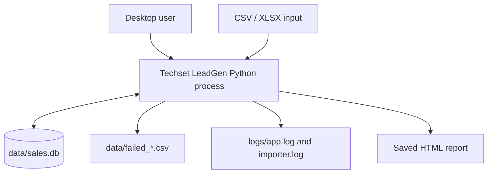
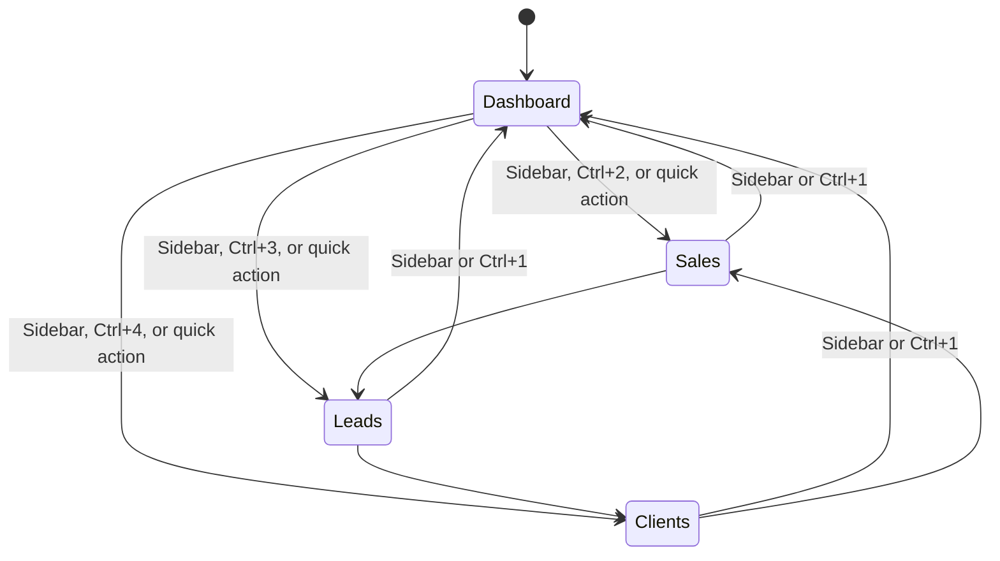
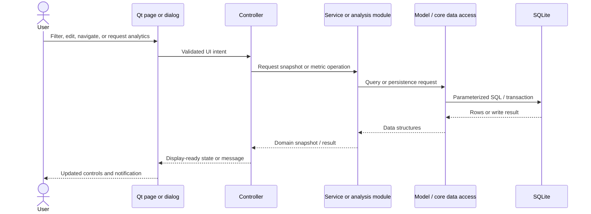
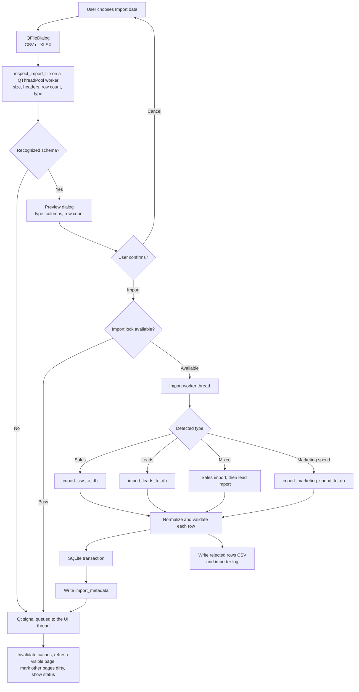
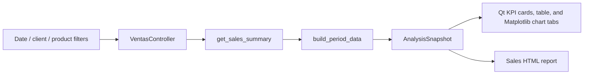
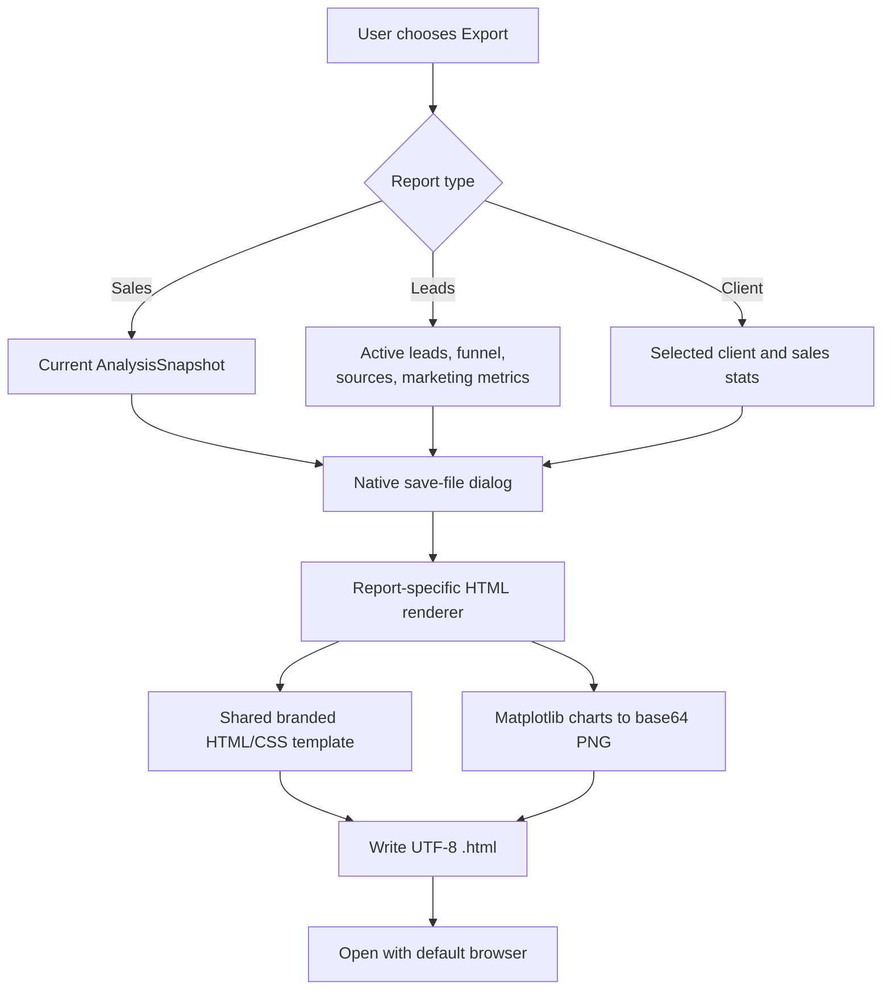
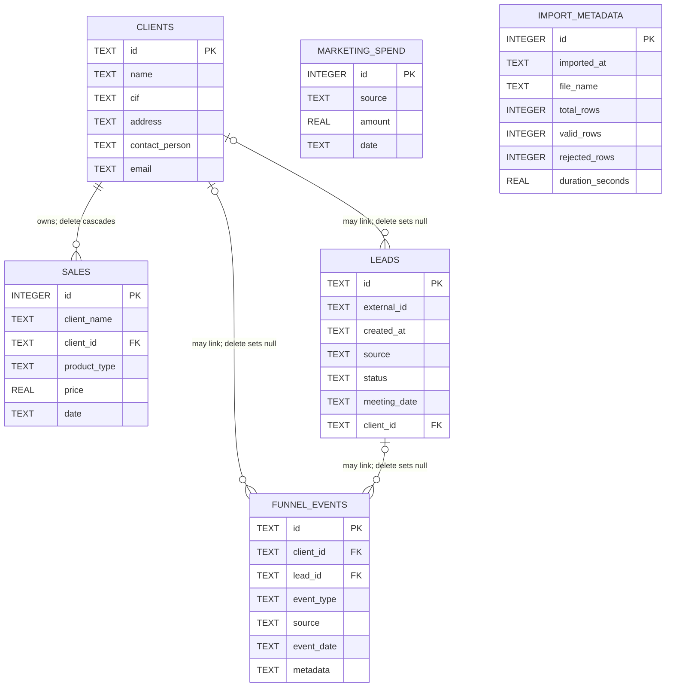

# Techset LeadGen Architecture

This document explains what the current application does, how its modules cooperate, and where data moves during its main workflows. It describes the repository as implemented; planned services or screens are not included.

## 1. System purpose and boundary

Techset LeadGen is a single-process desktop analytics and records application. A PySide6 (Qt Widgets) window provides four work areas—Dashboard, Sales, Leads, and Clients—and a local SQLite database is the durable store. Imports, calculations, record maintenance, and HTML report generation all run on the user's machine.

The runtime boundary is therefore one desktop process plus local files:



There is no separate backend server, HTTP API, authentication provider, browser route system, PWA, remote job queue, or cloud database in this repository. The `funnel_events` table is reserved in the schema, but current workflows do not write to it.

## 2. Startup and application shell

`main.py` is the entry point. `run()` performs the following lifecycle:

1. `configure_logging()` installs a WARNING console handler and a rotating `logs/app.log` handler (`TSLG_LOG_LEVEL`, falling back to the legacy `FDT_LOG_LEVEL`).
2. `create_application()` creates the single `QApplication` and sets the organization, domain, application name, and version used by `QSettings`.
3. `create_main_window()` creates and migrates the SQLite database through `core.db.init_db()`, applies the persisted light or dark theme through `ThemeManager`, and constructs `MainWindow`.
4. If initialization raises, the error is logged and a critical dialog names the log file; `run()` returns exit code 1.
5. Otherwise the window is shown and `QApplication.exec()` runs until the window closes.

`MainWindow` (`desktop_ui/main_window.py`) owns:

- the Techset Solutions logo, the **Techset LeadGen** name, and the tagline in the sidebar;
- one checkable navigation button per page with theme-aware line icons (`desktop_ui/icons.py`);
- a top bar with the section name and the light/dark toggle;
- a `QStackedWidget` that creates each page lazily on first visit and reuses it afterwards;
- the shared `ImportCoordinator`, the status bar, and the only error pop-up (`show_status`); and
- keyboard shortcuts: Ctrl+1–Ctrl+4 select a page and Ctrl+I starts an import.

Below 980 px the sidebar collapses to icons with tooltips. The minimum window size is 760 × 600 px. When a page reports a data change (`data_changed`), the shell marks the other constructed pages dirty and refreshes each one only when it is next shown. Closing the window is refused while an import or file inspection is running.



## 3. Architectural map

The predominant dependency direction is UI → coordination → data/analysis → SQLite. Reports branch from page data and domain snapshots.

```mermaid
flowchart TD
    Main[main.py<br/>startup, logging, QApplication]
    Brand[branding.py<br/>product identity and asset names]
    Theme[desktop_ui/theme.py<br/>tokens, palette, stylesheet, QSettings]
    Shell[desktop_ui/main_window.py<br/>sidebar, stack, status, shortcuts]
    Pages[desktop_ui/pages/<br/>Dashboard, Sales, Leads, Clients, dialogs]
    Widgets[desktop_ui/widgets.py, row_actions.py, icons.py<br/>shared Qt building blocks]
    Import[desktop_ui/importing.py<br/>picker, preview, worker bridge]
    Controllers[controllers/<br/>validation, filters, orchestration]
    Services[services/<br/>KPI and snapshot assembly]
    Domain[domain/<br/>snapshot and filter contracts]
    Analysis[analysis/<br/>SQL, Polars, grouping, metrics]
    Models[models/<br/>CRUD and persistence validation]
    Core[core/<br/>SQLite, import engine, date ranges]
    Utils[utils/<br/>formatting, templates]
    Reports[reports/<br/>HTML templates and Matplotlib]
    DB[(SQLite)]

    Main --> Brand
    Main --> Theme
    Main --> Core
    Main --> Shell
    Shell --> Pages
    Shell --> Import
    Shell --> Theme
    Pages --> Widgets
    Pages --> Controllers
    Pages --> Reports
    Import --> Controllers
    Import --> Core
    Controllers --> Services
    Controllers --> Analysis
    Controllers --> Models
    Controllers --> Core
    Services --> Analysis
    Services --> Domain
    Services --> Core
    Analysis --> Models
    Analysis --> Core
    Models --> Core
    Reports --> Domain
    Reports --> Utils
    Core --> DB
    Models --> DB
    Analysis --> DB
    Brand -. identity .-> Shell
    Theme -. presentation .-> Widgets
```



This is pragmatic layering, not an enforced boundary. Pages normally go through controllers, but `ClientsPage` also reads `analysis.leads_analysis.get_leads()` and `models.lead_manager.get_latest_lead_per_client()` directly, and `SalesPage` reads filter options from `analysis`. Pages accept their controllers, providers, and report generators as constructor arguments, which is how the headless tests isolate them.

## 4. Layer responsibilities

| Layer | Main responsibility | Representative files |
|---|---|---|
| Entry and identity | Configures logging, creates the Qt application, initializes the database, applies the theme, and defines canonical product strings | `main.py`, `branding.py` |
| Shell | Sidebar navigation, lazy page creation, dirty-page refresh, status messages, error dialogs, shortcuts, close guard | `desktop_ui/main_window.py` |
| Pages | Own screen state, connect widgets to controllers, render tables and charts, run dialogs, and start exports | `desktop_ui/pages/dashboard_page.py`, `sales_page.py`, `leads_page.py`, `clients_page.py`, `marketing_spend_dialog.py` |
| Shared Qt widgets | KPI cards, labeled fields, numeric-aware sortable items, bulk table population, painted row-action buttons, navigation icons | `desktop_ui/widgets.py`, `desktop_ui/row_actions.py`, `desktop_ui/icons.py` |
| Import bridge | File picker, background inspection, preview confirmation, and marshalling worker results onto the UI thread | `desktop_ui/importing.py` |
| Theme | Brand tokens, light/dark `QPalette` and stylesheet, Inter font registration, persisted theme preference | `desktop_ui/theme.py` |
| Controllers | Validate UI intent, hold filter/compare state, coordinate imports, call services/models, and convert exceptions into UI results | `controllers/` |
| Services | Assemble coherent dashboard and sales-analysis snapshots from lower-level queries | `services/` |
| Domain | Define UI-independent dataclasses, enums, source labels, compare presets, and filter constants | `domain/` |
| Analysis | Query and aggregate sales, lead, client, evolution, and marketing data; perform time grouping and chart sizing | `analysis/` |
| Models | Perform client, lead, duplicate-merge, and marketing-spend persistence operations and field validation | `models/` |
| Core | Own connections, schema/migrations, import parsing/transactions, and reusable date-range functions | `core/` |
| Reports | Render branded HTML and create embedded charts from already-prepared data | `reports/` |
| Utilities | Locale-independent formatting and import templates | `utils/` |
| Operations | Audit the database, diagnose imports, and benchmark queries | `scripts/` |

## 5. Repository structure

```text
TSLG/
├── main.py                     # logging, QApplication, startup error handling
├── branding.py                 # product name, tagline, asset names
├── pyproject.toml / poetry.lock
├── conftest.py                 # sandboxes data, logs, and Qt settings for pytest
├── assets/                     # official logos, favicon, Inter font, icons/chevron_*.svg
├── desktop_ui/
│   ├── main_window.py          # shell
│   ├── theme.py                # tokens, palette, stylesheet, ThemeManager
│   ├── importing.py            # ImportCoordinator and ImportPreviewDialog
│   ├── widgets.py              # Card, KpiCard, labeled_field, SortableItem, bulk_table_update
│   ├── row_actions.py          # RowActionDelegate and row context menus
│   ├── icons.py                # painted navigation icons
│   └── pages/
│       ├── dashboard_page.py
│       ├── sales_page.py
│       ├── leads_page.py       # includes LeadEditDialog
│       ├── clients_page.py     # includes ClientFormDialog and ClientDetailDialog
│       └── marketing_spend_dialog.py
├── controllers/                # dashboard, ventas (sales), leads, clients, import, filters, compare
├── services/                   # dashboard KPIs, period data, sales snapshots
├── domain/                     # AnalysisSnapshot, KPI snapshot, presets, source labels
├── analysis/                   # sales, leads, clients, marketing, evolution, time grouping
├── models/                     # clients, validators, duplicates, leads, marketing spend
├── core/                       # db.py, importer.py, date_range.py, SCHEMA.md
├── reports/                    # HTML template/sections, chart generator, three report writers
├── utils/                      # formatting.py, import_templates.py
├── scripts/                    # audit_db.py, diagnose_import.py, benchmark_queries.py
├── tests/                      # pytest suites, qt_helpers.py (drives real dialogs)
└── docs/                       # ARCHITECTURE.md, BRANDING.md, quality/
```

## 6. Screen behavior and ownership

### Dashboard

`DashboardPage` asks `DashboardController` for a frozen `DashboardKPISnapshot`. `DashboardKPIService` uses one connection and a small set of aggregate queries to produce sales/client counts, the latest import, total leads, leads with meetings, conversion rate, and leads created this month. The page renders these values as KPI cards.

Dashboard actions can:

- open the common import flow;
- save correctly structured CSV import templates for sales, leads, and marketing spend;
- navigate to Sales, Leads, or Clients; and
- clear sales, clients, or leads after confirmation.

Clear operations go through `DashboardController`; clearing clients also invalidates the client cache. The schema-level cascade means clearing clients removes their sales.

### Sales

`SalesPage` owns interactive filters, grouping selection, chart tabs (Trend, Products, Top clients, Period comparison), and the current `AnalysisSnapshot`. Charts are Matplotlib figures rendered off-screen (Agg) into Qt pixmaps. `VentasController` holds filter state and a snapshot cache keyed by date range, client, product, grouping, and dataset version.

Normal analysis produces:

- sales totals, transaction count, average ticket, quantity, and unique clients;
- a product summary table;
- product distribution data;
- sales evolution grouped by day, week, month, quarter, or year; and
- ranked clients.

Comparison mode prepares period A and period B independently, aligns their evolution series, and calculates deltas. `domain/analysis_snapshot.py` is the contract shared by the controller, the Qt page, and the sales report generator. Import success increments the dataset version and clears cached snapshots.

### Leads

`LeadsPage` loads enriched leads and reference dictionaries once per refresh, then filters in memory (search input is debounced by 200 ms). The controller delegates database queries and metrics to `analysis/leads_analysis.py` and `analysis/marketing_analysis.py`.

The screen combines:

- stage/source/date/search filters;
- funnel totals and conversion percentages;
- source ranking and average time to meeting;
- upcoming meetings;
- lead status and meeting-date editing;
- marketing spend editing (`MarketingSpendDialog`: add, correct, delete); and
- overall and per-source spend, attributed revenue, CPL, CAC, and ROI.

Lead stage storage uses `new`, `contacted`, `meeting`, `converted`, or `lost`; visible labels map those values to Lead, Contacted, Meeting, Client, and Lost.

### Clients

`ClientsPage` uses `ClientsController` for list/search, validation, create/update/delete, statistics, duplicate summaries, and duplicate merging. A client profile combines contact data, recent sales, and related lead information. Client deletion cascades to sales and sets linked lead references to `NULL`.

The model maintains a small client cache. Writes and imports invalidate it so list and profile reads do not retain stale client data.

## 7. Standard data flow

The user-facing screens normally follow this call path:



Some analysis modules obtain `core.db.get_connection()` directly, so the Model participant is optional for aggregate reads. Conversely, simple client or lead writes can go from a controller straight to a model without a service.

## 8. Import workflow

All imports (Dashboard, Sales, Ctrl+I) share `desktop_ui/importing.py` (`ImportCoordinator`) and `FileImportController`.



Important import properties:

- Inspection reads headers and counts rows without modifying SQLite.
- The controller uses a non-blocking process-wide lock; a second import receives a busy message.
- File inspection runs on a `QThreadPool` worker; parsing and database work run on a non-daemon `threading.Thread` that shutdown waits for.
- Worker results are emitted as Qt signals, which Qt queues onto the UI thread; widgets are never touched from worker threads.
- Detection prefers marketing spend over leads when a file has a spend amount column and no lead-only header, so `source, amount, date` files are never imported as leads.
- Sales, lead, and spend imports use explicit transactions. A dry-run path rolls the transaction back.
- Valid and invalid rows can coexist. Invalid rows are written with row number and reason.
- Sales imports create referenced clients before inserting sales.
- Mixed imports run the sales importer before the lead importer so new client links can resolve.

## 9. Analytics workflow

Sales analytics has the most structured data contract:



This shared snapshot prevents the report from silently re-querying different data after the screen has rendered. It contains metadata, filters, table rows, aggregate metrics, evolution, product distribution, ranked clients, and optional comparison data.

Dashboard KPIs use a smaller `DashboardKPISnapshot`. Lead and client reports currently consume dictionaries and lists already held by their pages rather than the sales snapshot type.

## 10. Report workflow



Report generators do not upload data. Generated charts are embedded as data URIs, so the report remains self-contained. Report opening is best-effort; the saved HTML still exists if the operating-system opener is unavailable.

## 11. Database model

`core/db.py` enables WAL mode and foreign keys on every connection. Dates are stored as ISO-formatted text.



`marketing_spend` and `import_metadata` have no foreign keys. See [core/SCHEMA.md](../core/SCHEMA.md) for column constraints, indexes, and migrations.

## 12. Theme and brand flow

Brand ownership is split deliberately:

- `branding.py` owns product text, the official website URL, asset names, and the font-family name.
- `desktop_ui/theme.py` owns the color tokens and builds the light/dark `QPalette` and one global stylesheet from them; `ThemeManager` persists the choice in `QSettings`.
- `desktop_ui/icons.py` draws navigation icons in the active text color; `RowActionDelegate` picks an error tone readable on the active surface.
- `reports/html_template.py` carries the same identity into exported HTML.

`ThemeManager.apply()` sets the palette and stylesheet on the `QApplication` and emits `theme_changed`; the shell recolors its icons and relabels the toggle from that signal. The official logo artwork itself is not recolored. See [BRANDING.md](BRANDING.md) for values and provenance.

## 13. Concurrency and cache behavior

- Imports run on a non-daemon worker thread; inspections run on a single-thread `QThreadPool`.
- `FileImportController` serializes imports with a module-level lock.
- Worker callbacks emit Qt signals that are delivered on the UI thread.
- The Sales controller caches normal-mode snapshots. Its key includes all filters, grouping, and a dataset version.
- A successful import invalidates the Sales snapshot cache and the client cache.
- The client manager caches client lookup data; client writes and duplicate merges invalidate it.
- SQLite uses a five-second connection timeout and WAL journaling.

The application is still designed around one user process. These mechanisms keep its UI responsive and internal state current; they are not a substitute for distributed locking or multi-user transactions.

## 14. Configuration and generated files

| Item | Default path or value | Owner |
|---|---|---|
| Database | `data/sales.db` | `core/db.py` |
| Rejected imports | `data/failed_*.csv` | `core/importer.py` |
| Application log | `logs/app.log` (`TSLG_LOG_LEVEL` or `FDT_LOG_LEVEL`) | `main.py` |
| Import log | `logs/importer.log` | `core/importer.py` |
| Theme at startup | Last choice saved in `QSettings` (light by default) | `desktop_ui/theme.py` |
| Window size | 1360 × 860 px initially; 760 × 600 px minimum | `desktop_ui/main_window.py` |
| Import limit | 50 MB | `core/importer.py` |

The environment names `FDT_DATA_DIR`, `FDT_LOG_DIR`, and `FDT_LOG_LEVEL` are legacy compatibility interfaces. They remain intentionally unchanged while all visible product copy uses Techset LeadGen.

## 15. Verification surfaces

The repository configures its checks in `pyproject.toml`:

```bash
poetry check
poetry build
poetry run pytest
poetry run pytest --cov
poetry run ruff check .
poetry run mypy
poetry run bandit -c pyproject.toml -r . --severity-level medium --confidence-level high
poetry run pip-audit
```

`mypy` targets `core`, `models`, `controllers`, `services`, `analysis`, `domain`, `utils`, `reports`, `desktop_ui`, `main.py`, and `branding.py`. The pytest root fixture redirects the database, logs, and Qt settings (`XDG_CONFIG_HOME`) to a temporary sandbox. GUI tests run headless (`QT_QPA_PLATFORM=offscreen`) against the real widgets; `tests/qt_helpers.py` answers the production dialogs instead of mocking them. A native-platform smoke run is still needed for window-manager behavior. See [quality/](quality/) for the audit reports.
