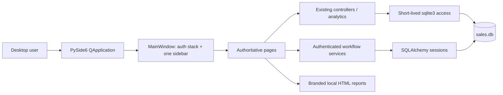
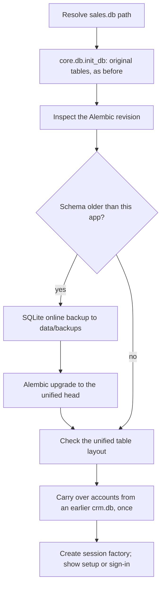

# Techset LeadGen architecture

Last audited: 21 October 2026

## Architectural intent

Techset LeadGen is one native PySide6 desktop process with one navigation system and one local SQLite database. The redesign extends the established analytics application; it does not embed a web frontend and does not introduce a second CRM application.

The authoritative work areas are Dashboard, Sales, Leads, Clients, Tasks, Users, Audit log, and Settings. Dashboard, Sales, Leads, and Clients each exist once. New contact, assignment, activity, task, account, and audit capabilities are integrated with those existing records.

The directory named `crm/` is an internal domain/service layer. It has no route, tab, main window, or independent live database.

## Runtime composition



`main.py` configures logging and Qt application metadata, applies the shared theme, and constructs `MainWindow`. `MainWindow` creates only the authentication screens initially. It opens the application context, performs safe schema preparation, and shows first-run setup or sign-in. Signed-in pages are lazy-created from one page-factory map and discarded on sign-out so one user's cached data cannot leak into another session.

## Navigation and permissions

`desktop_ui/main_window.py` owns the sole `SECTIONS` registry:

| Key | Screen | Visibility permission |
|---|---|---|
| `dashboard` | Dashboard | `sales.view` |
| `sales` | Sales | `sales.view` |
| `leads` | Leads | `leads.view` |
| `clients` | Clients | `clients.view` |
| `tasks` | Tasks | `tasks.view` |
| `users` | Users | `users.view` |
| `audit` | Audit log | `audit.view` |
| `settings` | Settings | Any signed-in user |

Hiding an entry is not the security boundary. `AppContext.run()` revalidates the signed-in session, builds an `Actor`, and each service requires the relevant permission/scope before it reads or changes protected data.

Global search calls one search service and deep-links a result into the existing Leads or Clients page. Dashboard metric/work actions use the same navigation API. No secondary record router exists.

## Feature execution paths

### Dashboard

```text
DashboardPage
  -> DashboardController / dashboard_kpi_service
  -> analysis and SQL aggregates
  -> sales.db
  -> KpiCard, data status, and real user-work summary
```

The work summary uses authenticated task/lead services. Import and destructive maintenance controls are permission-gated. Data-clearing actions require explicit confirmation and invalidate already-loaded pages.

### Sales

```text
SalesPage
  -> VentasController + CompareController
  -> snapshot_builder / analysis modules
  -> sales, clients
  -> one immutable AnalysisSnapshot
  -> KPI cards, Qt-rendered Matplotlib charts, product table, HTML report
```

The report consumes the visible snapshot rather than querying again. Comparison state remains in the established controller. The page can ask the shell to start the shared importer; it does not own another import stack.

### Leads

```text
LeadsPage
  -> LeadsController for the existing analytical snapshot
  -> crm.services.leads for ownership/workflow extras and mutations
  -> the same leads rows in sales.db
  -> funnel, marketing, meetings, management table, dialogs/timeline/tasks
```

Imported and manually created leads therefore participate in the same stage vocabulary and screen. Stage history, assignment, qualification reasons, tasks, and activity do not create a parallel lead record.

### Clients

```text
ClientsPage
  -> ClientsController for established sales statistics and list data
  -> crm.services.clients/contacts/activities/tasks for authenticated workflow data
  -> the same clients rows in sales.db
  -> list, profile dialog, contacts/activity/tasks, report
```

The duplicate-client workflow must reassign every dependent record before deleting a secondary identity: sales, leads, funnel events, contacts, activities, and tasks. It also preserves the surviving workflow metadata and increments its optimistic version.

### Tasks, Users, Audit, Settings

These are genuinely distinct workflows, not containers for copied Sales/Leads screens. They use the reusable `RecordPage` paging/list/detail shell or a dedicated settings view. SQL sorting and pagination keep large lists bounded.

## Persistence ownership

The default path is derived in `core/db.py` as `<data directory>/sales.db`; `FDT_DATA_DIR` overrides the directory. Both persistence APIs target that exact path.

| Tables | Logical owner | Notes |
|---|---|---|
| `clients`, `leads` | Shared | Created for the original app and mapped by SQLAlchemy after workflow columns are added. |
| `sales`, `marketing_spend`, `import_metadata`, `funnel_events` | Core/import/analytics | Kept in the raw-SQL layer and explicitly protected from Alembic autogenerate removal. |
| `contacts`, `activities`, `tasks`, `lead_status_history` | Workflow services | Reference the shared client/lead identities. |
| `organization`, `users`, `user_sessions`, `user_tokens`, `auth_attempts`, `audit_logs` | Identity/security services | Local authentication, authorization, and audit evidence. |

Raw analytics/import code and SQLAlchemy services coexist for compatibility. Connections are short lived, enable foreign keys and WAL, and use the same busy timeout. Read-only ORM transactions must not reserve SQLite's writer slot.

This mixed access is a deliberate transition boundary, not permission to add another data store. New authenticated mutations should be implemented in services and audited in the same unit of work. Legacy operations that still use their own transaction are wrapped with permission and audit handling and are documented as a boundary to continue reducing.

## Schema and migration safety

Startup follows this order:



An earlier standalone `crm.db` used an incompatible schema but the same revision label (`0001`) as the unified schema, so readiness is not decided by the revision string alone. After any upgrade, `crm.migrations_util.layout_problems()` checks the tables and key columns the unified revision creates; a file that does not match (for example the old standalone CRM file selected as the active database) is refused with an explanation and left unchanged.

The old file is left untouched. Account carry-over is allowed only when its business tables are empty. If it contains companies, contacts, leads, activities, tasks, or history that the unified schema cannot losslessly represent, startup stops with an actionable message rather than silently copying only accounts.

Historical migration DDL is frozen inside its revision. Alembic autogenerate explicitly excludes independently core-owned tables. Destructive downgrade is unsupported; recovery uses the automatic pre-migration backup.

See [core/SCHEMA.md](../core/SCHEMA.md) for the table-level contract.

## Authentication and session lifecycle

- First run creates one organization and Super Admin.
- Passwords use Argon2; plain text is never stored. The password policy (`crm/security/passwords.py`) runs in the service layer for first-run setup, code activation and password reset, and password change, so no screen can skip it; the screens' live checklist calls the same rule checks. The common-password list ships with the app (`crm/security/COMMON_PASSWORDS.md`); passwords are never sent to an online service.
- Sign-in attempts are recorded and failure windows are enforced.
- Invitation/reset tokens and session tokens are stored only as hashes.
- The raw session token remains in memory for the current window.
- Each unit of work rechecks expiry, revocation, user activity, and role.
- A role change, deactivation, password change, or remote revocation takes effect without restarting the application.
- The Qt event filter notes real keyboard/mouse/wheel input; periodic verification does not manufacture activity.
- Signing out closes old dialogs, drops lazy pages, and releases their user-specific state.

## UI system

`desktop_ui/theme.py` is the visual source of truth. It defines Techset green/gold/ink colors, semantic success/warning/error states, light and dark palettes, focus rings, table/form states, and component styling. `ThemeManager` persists the selected mode in `QSettings`.

Shared components in `desktop_ui/widgets.py` include page headings, cards, KPI cards, empty states, labeled fields, sortable table items, and safe bulk-table population.

Every table goes through `desktop_ui/tables.py` (`prepare_table`, or `set_table_defaults` / `bulk_table_update`, which call it): one row height, no grid, alternating rows, whole-row hover and selection with a green edge, numbers right-aligned under right-aligned headings, coloured badges for stages, priorities, and statuses (`BADGE_TONES`, contrast ≥ 4.5:1 in both themes), a message inside the table when it is empty, Ctrl+C to copy the selected rows with headings, and full text on hover for shortened cells. `fit_columns` sizes columns to their contents and, when they do not fit, shortens the widest text columns first (dates, numbers, badges, and `keep_columns` are never shortened) so row actions stay on screen; `enable_column_choice` lets people hide columns from the header's right-click menu and remembers the choice in `QSettings`. Dates in tables are shown as "09 Oct 2026" (`support.date_text`) and sort by their ISO value. Pages use responsive grids/reflow at the supported minimum size. At compact width the sidebar becomes icon-only with tooltips, and the top bar reduces redundant copy without hiding account/theme access.

Sales charts use Matplotlib's non-interactive Agg renderer and are copied into native Qt pixmaps. Their surfaces/text/grid colors are derived from the current Qt palette and are redrawn when the theme changes.

Form validation stays next to the relevant input and preserves user-entered values. Destructive actions use branded confirmation dialogs. Status text is inline; the shell is the single owner of error pop-ups, avoiding duplicate dialogs.

## Background work and responsiveness

File inspection/import is coordinated by `ImportCoordinator`. Inspection runs in a `QRunnable`, preview remains on the GUI thread, and only one import job can run at a time. The shell prevents shutdown during a live import and invalidates data pages after success.

Analytics queries and smaller authenticated units of work are synchronous today. Pages show a busy cursor/status while they run. Any future long-running database work must use a worker with its own connection/session; Qt widgets must only be changed on the GUI thread.

## Reports and exports

Reports are local, self-contained HTML with Techset branding. Sales exports use `AnalysisSnapshot`; Leads exports use the active filtered snapshot plus marketing metrics; Client exports use the selected client and established sales statistics. User-provided text is escaped. Undefined ratios, such as CPL/CAC/ROI with no spend, display an em dash rather than a fabricated zero.

## Testing boundaries

The root pytest configuration redirects data, logs, Qt settings, and caches to temporary locations. CRM fixtures migrate a fresh SQLite template and copy it per test. GUI tests instantiate and drive real PySide6 widgets with `QT_QPA_PLATFORM=offscreen`; dialog pilots answer production dialogs without replacing business services.

The suite covers:

- the unique navigation registry and role visibility;
- first-run/auth/session/permission workflows;
- shared client/lead persistence and CRUD;
- imports, filters, charts, reports, and restart behavior;
- duplicate merge and migration integrity;
- narrow-window layout, focus, keyboard access, and theme behavior;
- query-count scaling for important lists/aggregates.

Offscreen rendering does not verify the native window manager, file picker, browser launch, platform font rendering, or Windows executable. Those remain manual release checks.

## Packaging

Poetry builds the source distribution/wheel. A PyInstaller specification builds a windowed one-folder desktop bundle and includes assets, time-zone data, and Alembic migration resources. PyInstaller does not cross-compile: Windows artifacts must be built and tested on Windows. The provided PowerShell script runs tests, creates the `.exe` bundle, and zips it; it does not create or sign an installer.

## Known architectural boundaries

- Local SQLite is designed for a local desktop deployment, not shared network storage or cloud synchronization.
- A few legacy raw mutations cannot make their external operation and audit row fully atomic yet; new code should move those behaviors into transaction-aware services.
- Rich business records from the incompatible standalone CRM need a dedicated, field-mapped migration tool; automatic startup intentionally refuses a lossy conversion.
- Runtime databases must remain outside version control and release artifacts.
