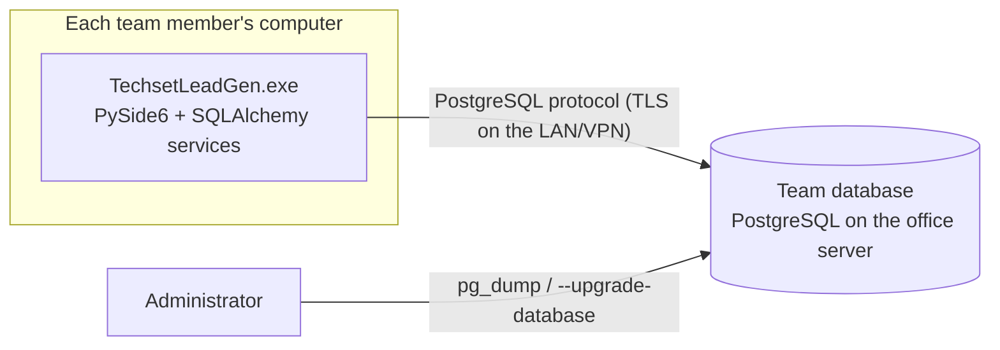

# Techset LeadGen architecture

Last updated: 28 October 2026. Describes the code as it is in `src/techset_leadgen`.

## What the product is

A native PySide6 desktop application for a team doing LinkedIn outreach by hand. A manager
imports LinkedIn profile addresses, assigns them to team members for a work day, and follows
progress; members record what happened on LinkedIn, schedule follow-ups, and complete their
work; everyone has general tasks. There is no browser interface, no web view, and nothing in the
application contacts LinkedIn: members open profiles in their own browser and record outcomes.

The original sales, lead, and client analytics are retired from the main workflow. They are kept,
unchanged, as the **Archive** (single-computer installations only) and their tables are preserved.

## Deployment model



* **Team server (25+ computers).** Every desktop connects directly to one PostgreSQL database
  (`TSLG_DATABASE_URL` or `data/database.ini`). The database is the single source of truth for
  assignments, outreach history, follow-ups, tasks, accounts, sessions, notifications, and audit.
  Chosen by the owner on 27 Oct 2026 as the smallest reliable option: the existing
  service layer, permission checks, and constraints work unchanged, and concurrency is handled by
  the database. Trade-off (accepted): authorization runs inside each desktop, so the database
  password must be protected (see `docs/DEPLOYMENT.md`, "Security of the team database"). The
  service layer is the boundary a future private API server would reuse unchanged.
* **Single computer.** One local SQLite file (`data/sales.db`). The Archive analytics, file
  backups from Settings, and data clearing exist only here (they use raw SQLite).
* **No offline editing** (owner decision). Without the server the application says so
  ("The team database server cannot be reached") and saves nothing; there is no local queue.

Rejected: one SQLite file on a network share (SQLite's locking is unreliable on network file
systems; corruption risk), and independent local databases (no shared assignments).

## Layers

```
src/techset_leadgen/
├── main.py, __main__.py      entry point (logging, QApplication, admin commands)
├── config.py, cli.py         settings (database address, session policy); administrator commands
├── desktop/                  PySide6 only: shell, pages, dialogs, theme, tables (no business rules)
│   └── pages/                outreach_pages (My Work, Follow-ups), assignment_pages, team_pages,
│                             meetings_page, prospects_page, operational_dashboard_page, tasks_page, admin, settings,
│                             and the archive pages (dashboard_page, sales_page, leads_page, clients_page)
├── services/                 one module per workflow; each call takes (session, Actor) and enforces
│                             permissions, validates input, writes the audit trail, never commits
├── domain/                   vocabularies and pure rules: outreach stages, transitions, balance_plan
├── database/                 engine.py (engine/types), models/ (ORM), migrations/ (Alembic),
│                             migrations_util, transfer (SQLite→PostgreSQL), server_backup, local_db
├── security/                 Argon2 passwords, tokens, the role → permission matrix
├── reports/, analytics/      branded HTML reports; the retired analytics (archive)
└── assets/, utils/
```

Dependencies point one way: `desktop` → `services` → `domain` / `database` / `security`.

### A unit of work

```text
Page action ──► AppContext.run(lambda db, actor: service(db, actor, …))
                 ├─ opens one session (one transaction)
                 ├─ re-checks the signed-in session (expiry, revocation, active user, role)
                 ├─ builds Actor (permissions with ALL/OWN scope)
                 ├─ service: authorize → validate → change → audit (same transaction)
                 └─ commit, or roll back on any error (shown by support.report)
AppContext.write(kind, …) also announces the change so other pages refresh when next shown.
```

Errors reach the user through one path (`desktop/support.explain`): validation and permission
messages, "changed by someone else" for version conflicts, "would duplicate a record" for
unique-constraint races, and "the team database server could not be reached" for network errors.

## Navigation (desktop/main_window.SECTIONS)

| Group | Area | Shown with |
|---|---|---|
| Overview | Dashboard (operational KPIs, workload) | everyone |
| | My Work | `outreach.record` |
| | Notifications | everyone |
| Outreach | Daily Assignments | `assignments.manage` |
| | Meetings (cards, list, scheduling form) | `meetings.view` |
| | Prospects | `prospects.view` |
| | Follow-ups | `prospects.view` |
| | Tasks (general tasks) | `tasks.view` |
| Manage | Team performance (end-of-day summary, CSV export) | `team.view` |
| | Users & roles, Audit log, Settings | `users.view`, `audit.view`, everyone |
| Archive | Sales overview, Sales, Leads, Clients | `archive.view`, local file only |

Hiding an entry is a convenience; every service checks the permission again.

## Concurrency and consistency

* One open assignment per prospect: partial unique index `uq_prospect_assignments_open`.
  Two managers assigning the same profile at the same moment: one succeeds, the other sees a
  conflict (tested on PostgreSQL with two simultaneous connections).
* One open follow-up per prospect: partial unique index `uq_tasks_open_follow_up`.
* Retried saves: `outreach_events.request_id` and `tasks.request_id` are unique; each dialog sends
  one request ID for all its attempts, so a save retried after a timeout is stored once.
* Lost updates: `version` columns (`version_id_col`) on prospects, batches, assignments, tasks;
  the screens pass the version they showed, and a stale change is refused.
* SQLite serializes writers with `BEGIN IMMEDIATE`; PostgreSQL uses READ COMMITTED with the
  constraints above, `lock_timeout` 10 s and `statement_timeout` 30 s.
* Reassignment closes the old assignment (`reassigned`) and creates a successor linked by
  `previous_assignment_id`; the old assignee can no longer record or complete it.
* Meetings: no two scheduled meetings of one client or one attendee may overlap or come closer than
  the organization's buffer. Each booking locks the client's and attendees' rows
  (`SELECT … FOR NO KEY UPDATE`, fixed order) before its final check, so two computers booking the
  same person or client at once cannot both succeed (tested on PostgreSQL, including a held lock).
  Rules and suggestions: `domain/scheduling.py`; details: `docs/DOMAIN_MODEL.md`, "Meetings".

## Query performance (N+1 prevention)

Each list screen loads one page with a fixed number of statements: joined eager loading for the
rows' many-to-one relations (`joinedload` for assignment → prospect/assignee/batch, task →
assignee/prospect), a single grouped query per aggregate (dashboard, workload, end-of-day summary,
batch counts, member workload), capped histories (`prospects.history`, 100 entries per kind), and
batched lookups and inserts for imports. `tests/integration/test_query_counts.py` loads every
screen with 5 and 50 rows and requires the same statement count; measured timings are in
`docs/IMPLEMENTATION_LOG.md`.

## Time

Timestamps are stored as UTC (`UTCDateTime`). "Today", due today, and the end-of-day summary use
the organization's business time zone for team views (Settings → Edit organization) and the user's
own time zone for personal views. Day boundaries are computed per calendar day, so daylight-saving
days have 23 or 25 hours. Overdue is derived (due time passed and still open); nothing rewrites
rows on a schedule. Notifications are stored rows, so they wait while the application is closed;
there are no operating-system pop-ups.

## Responsiveness

Prospect files and the archive's sales/lead imports are read by `QRunnable` workers; results come
back through Qt signals. Units of work run on the GUI thread with a busy cursor; they are bounded
paginated queries (p95 under 40 ms on PostgreSQL with 5,000 prospects, see the implementation
log). A server outage fails within the 10 s connect timeout.
